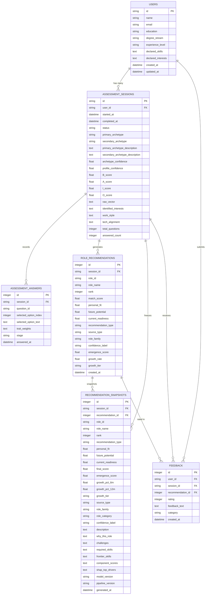

# Database Architecture

## 1. System Architecture & Data Layer Separation

The **Proactive IT Role & Skill Emergence Forecaster** maintains a strict architectural separation between **ML Datasets / Model Artifacts** and the **Persistent Application Database (SQLite)**.

```
┌──────────────────────────────────────────────────────────────────────────┐
│                             ML DATA LAYER                                │
│   - Raw Job Listings (Adzuna, LinkedIn, Naukri CSVs)                    │
│   - Cleaned & Standardized Datasets (data/cleaned/, data/standardized/)  │
│   - Feature Matrices (data/features/master_role_month_features.csv)      │
│   - SBERT 384-dim Embeddings Cache (data/embeddings/)                   │
│   - HDBSCAN Clusters & Longitudinal Tracking (data/clusters/)            │
│   - Trained Models (models/final_model.joblib)                           │
│   - Role Catalog & Predictions (data/role_catalog/emerging_roles.json)   │
└────────────────────────────────────┬─────────────────────────────────────┘
                                     │ File-Based Artifacts
                                     ▼
┌──────────────────────────────────────────────────────────────────────────┐
│                      RECOMMENDATION ENGINE LAYER                         │
│   - Psychometric BAIO Profiling (src/recommendation/profile_engine.py)   │
│   - Multi-Factor Role Matcher (src/recommendation/role_matcher.py)       │
│   - Empirical Skill Gap Analysis (src/recommendation/skill_gap.py)       │
│   - Rule-Based Learning Roadmap (src/recommendation/roadmap.py)          │
└──────────────────────┬────────────────────────────┬──────────────────────┘
                       │ Top Matches                │ Snapshots
                       ▼                            ▼
┌──────────────────────────────────────────────────────────────────────────┐
│                     APPLICATION DATABASE (SQLITE)                        │
│             data/application/career_recommendation.db                    │
│                                                                          │
│   • users                     • assessment_sessions                      │
│   • assessment_answers        • role_recommendations                     │
│   • recommendation_snapshots  • feedback                                 │
└──────────────────────▲────────────────────────────▲──────────────────────┘
                       │ Read / Write               │ Read / Write
        ┌──────────────┴──────────┐   ┌─────────────┴────────────┐
        │     FASTAPI BACKEND     │   │      STREAMLIT UI        │
        │    (REST API Server)    │   │  (Interactive Frontend)  │
        └─────────────────────────┘   └──────────────────────────┘
```

---

## 2. Why SQLite?

1. **Lightweight & Serverless**: Zero configuration or external database server required; ideal for standalone deployments and reproducible research environments.
2. **ACID Compliant**: Guarantees atomic transactions, data integrity, and rollback safety across multi-step questionnaire sessions.
3. **Thread-Safe with FastAPI & Streamlit**: Configured with `check_same_thread=False` and SQLite foreign key constraints (`PRAGMA foreign_keys=ON`).
4. **Isolated Application State**: Clearly delineates transient/user-facing application data from heavy numerical ML computation files.

---

## 3. Relational Schema Overview



---

## 4. Recommendation Snapshots & Immutability

### Problem
ML pipelines are continually updated and retrained on new job market data. If recommendations were dynamically recomputed on every view, a user returning to view their past career assessment could see different recommendations than what was originally presented.

### Solution: Versioned Recommendation Snapshots
When recommendations are generated, the system creates frozen `RecommendationSnapshot` records containing:
- Complete score triad (`personal_fit`, `future_potential`, `current_readiness`, `final_score`)
- Role attributes, growth projections, and SHAP drivers
- Specific skill requirements and why/challenges explanations
- Model and Pipeline version tags (`model_version="v2.0.0"`, `pipeline_version="v2.0.0"`)
- Generation timestamp (`generated_at`)

When a user visits **Assessment History**, the system reads these immutable snapshots, ensuring 100% reproducible historical assessment records.

---

## 5. Database Initializer

Initialize the SQLite schema at any time using:

```bash
python -m backend.init_db
```

This creates `data/application/career_recommendation.db` and all tables with appropriate indexes and foreign key constraints without wiping existing data.
